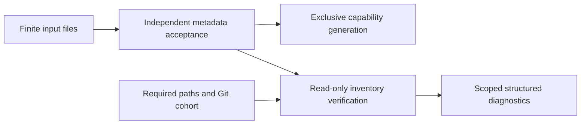

<!--
SPDX-License-Identifier: AGPL-3.0-or-later
Commercial license available
© Concepts 1996–2026 Miroslav Šotek. All rights reserved.
© Code 2020–2026 Miroslav Šotek. All rights reserved.
ORCID: 0009-0009-3560-0851
Contact: www.anulum.li | protoscience@anulum.li
SPIKE-GROUNDTRUTH — repository governance and provenance
-->

# Component architecture

Repository metadata is accepted before any generated inventory is needed. `inputs` reads finite regular files and parses strict UTF-8 JSON. `metadata` independently pins the reviewed closed schema and checks actual interpreter and lock identities. `report` aggregates safe diagnostics with deterministic failure precedence. `cli` exposes fixed operations and refuses failed report delivery.

`capabilities` constructs the empty initial inventory with a SHA-256 of exact metadata source bytes. Exclusive publication creates a complete file without replacing an existing path. `structure` checks required paths and the actual Git-maintained source cohort, including nonignored untracked files during initial construction. Ignored working caches do not become maintained source.

The graph has no self-digest or metadata/inventory dependency cycle. Domain manifests will consume the sole qualified evidence-manifest toolkit; these validators do not duplicate its signing, canonicalisation or domain verification logic.
